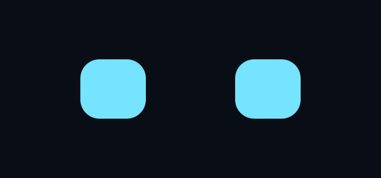
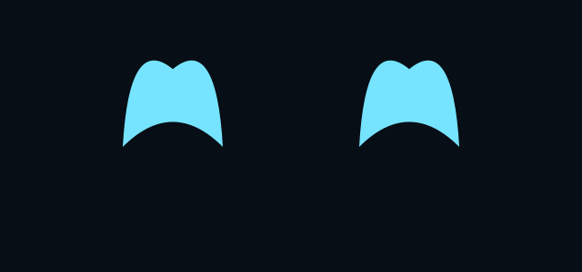
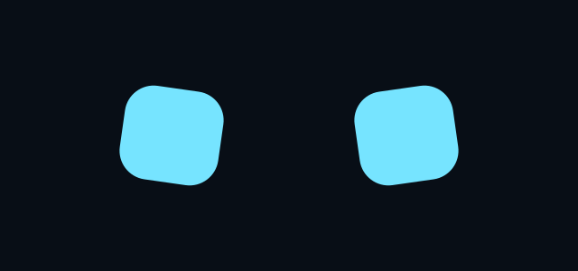
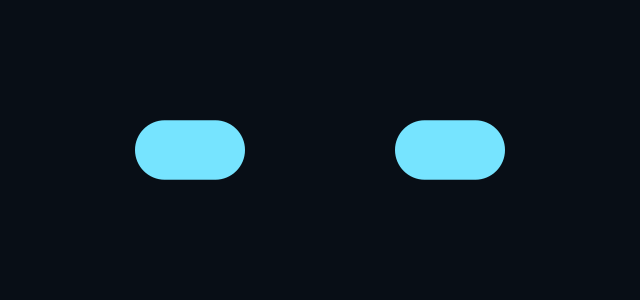
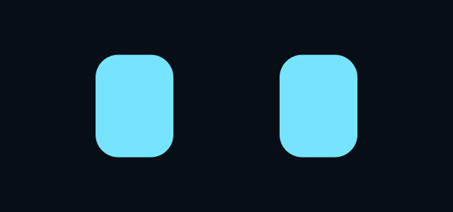
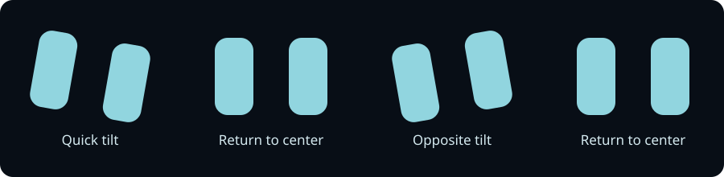
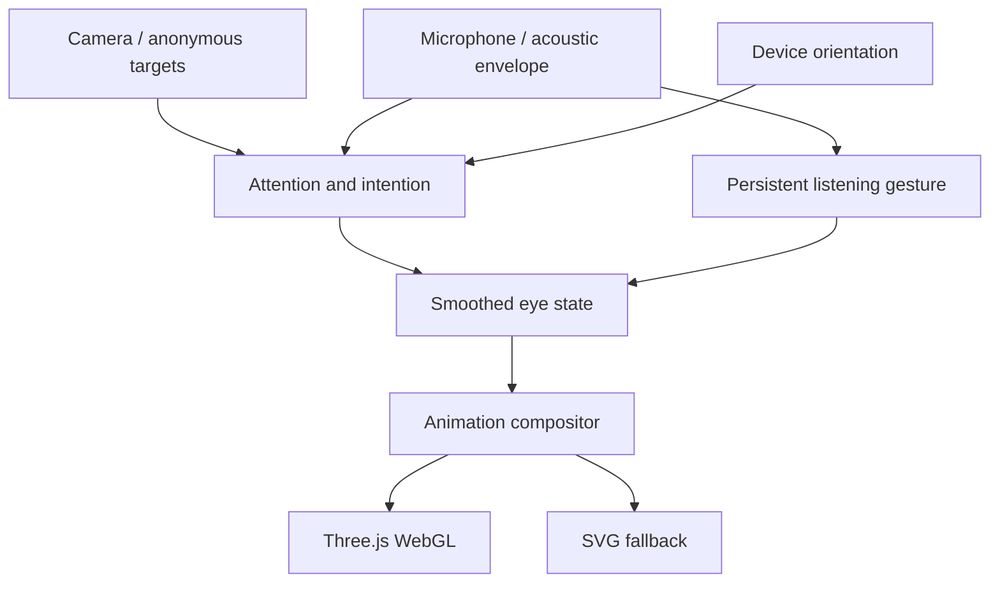

# Affective Eye Engine

Hardware-agnostic, procedural eyes driven by local face detection, anonymous attention tracking, device orientation, acoustic perception, persistent attention, and procedural affective gestures. The camera is **never rendered as a preview**.

[**Launch inspector**](https://cdaprod.github.io/affective-eye-engine/index.html) · [**Expression gallery**](https://cdaprod.github.io/affective-eye-engine/gallery.html) · [**Actions**](https://github.com/Cdaprod/affective-eye-engine/actions)

## Cinematic preview

[](https://cdaprod.github.io/affective-eye-engine/index.html)

| Dark glass | Portrait |
| --- | --- |
|  |  |

These browser captures are published by CI from the latest successful Pages deployment.

### Expression vocabulary

| Neutral | Curious | Happy |
| --- | --- | --- |
|  |  |  |
|  |  |  |
| Focused | Sleepy | Surprised |



*Illustrative listening poses, not a browser capture.*

## Integrated behavior

All previous capabilities are retained: high-gain gaze (5.5), damped overshoot, adaptive tracking, native camera constraints and minimum zoom where available, peripheral memory, proximity scale (0.65–1.4), autonomous contextual emotes, orientation, simulation and SVG snapshots. The gallery now includes generated gaze, proximity and six emote animations. Disable autonomous emotes to isolate gaze and proximity during testing.

## Multimodal behavior

- Visual intention: confirmed visual acquisition, remembered targets, searching, settling and resting; gaze and proximity use separate smoothing.
- Acoustic perception: optional local microphone, stereo RMS balance where two channels are exposed, mono fallback, acoustic activity and visual target association.
- Listening gestures: shared facial pivot, 100 ms onset confirmation on the smoothed acoustic envelope, initial bilateral 10° sweep (120 ms attack, 80 ms hold, 240 ms direct crossover, 80 ms hold, 120 ms return), followed by alternating short pulses at least 1.9 s between onsets, 1.8 s quiet confirmation, and suppression of competing automatic emotes during listening.

Neural Silero VAD is attempted on microphone activation, with an acoustic energy fallback when unavailable. Stereo balance is not calibrated direction of arrival. Sustained noise may trigger periodic listening gestures; voice activity detection and conversational acknowledgments are future work.



## Cinematic rendering

The immersive viewport now defaults to a real Three.js WebGL shader renderer. Two signed-distance-field eye shapes are shaded with procedural lighting, responsive glints, material gradients, filmic color mapping, analytical bloom, velocity-driven squash/stretch, subtle breathing and temporal expression morphs. No external 3D models or camera texture uploads are needed.

Tap anywhere to open the inspector overlay. Renderer modes: **Cinematic (WebGL)**, **Ultra (WebGL + UnrealBloomPass/OutputPass when quality is High)**, and **Classic (SVG)**. Choose Lightweight/Balanced/High performance profiles, luminous/glass materials, emission and bloom intensity. WebGL context loss or initialization failure falls back to the existing SVG geometry. The renderer reads the *same* state pipeline for gaze, face proximity, blink, emotes, and orientation; it never independently calls camera APIs.

**Important:** selecting Ultra with Balanced quality uses analytical bloom only until High quality is chosen. On iOS, browsers may limit fullscreen APIs, WebGL capability, screen refresh rate, and camera FOV. Visual quality and 60 FPS are targets, not guarantees.

### Cinematic browser captures

After `npm install && npm run build`, run `npx playwright install chromium` then `npm run render:cinematic`. This launches a local Vite preview, captures **actual** WebGL screenshots of cinematic and glass materials, plus portrait and SVG fallback, and writes `artifacts/cinematic/*.png`. GitHub Actions runs the capture on the pull-request validation path. This is a browser render, not a programmatic SVG imitation.

## Quick start

Requires Node.js 22:

```sh
npm install
npm test
npm run render
npm run build
npm run dev
```

Open the Vite URL. Camera access requires HTTPS or localhost; on an iPhone use the GitHub Pages endpoint. Camera and orientation permissions must be granted through user gestures.

### Inspector operations

The eyes occupy the entire viewport by default. Tap the eyes to reveal or dismiss the overlay controls. Use Enter fullscreen where the browser supports it; on iPhone browser chrome may remain. The eye aspect ratio is preserved in portrait and landscape. Sensors continue running when controls are hidden.


- **Enable camera:** start local MediaPipe BlazeFace inference; choose and follow temporary anonymous targets, prioritizing audiovisual speaking cues and acknowledging other faces during quiet intervals.
- **Enable orientation:** read the browser device-orientation event and apply simple tilt compensation (not calibrated 3D tracking).
- **Toggle two-person simulation:** deterministic synthetic targets, no camera required.
- **Toggle microphone:** explicitly grant local audio access; no recording or playback.
- **Stop sensors:** release audio and video tracks, deactivate orientation, and stop the simulation.
- **Save SVG snapshot:** export the currently rendered procedural eye geometry without capturing any camera frames.
- **Gallery:** examine all six expressions from the canonical geometry engine.

### Generated render artifacts

`npm run render` creates deterministic SVGs and a manifest:

- `artifacts/previews/*.svg` — six expression presets
- `artifacts/contact-sheet.svg` — combined comparison sheet
- `artifacts/animations/attention-switch.svg` — animated two-target gaze transition
- `artifacts/manifest.json` — reproducible rendering parameters
- `artifacts/cinematic/*.png` — actual headless Chromium screenshots of WebGL cinematic, glass, portrait and SVG fallback modes

The workflow uploads the artifacts separately and copies them into the public site. The contact sheet and animation are generated by CI; the six baseline previews are included in the repository.

## Deployment prerequisite

In [**Settings → Pages**](https://github.com/Cdaprod/affective-eye-engine/settings/pages), set **Build and deployment → Source: GitHub Actions**. Until Pages is enabled, deployment fails with HTTP 404 even when all tests and the Vite build succeed. GitHub App repository write permissions do not imply administration access to change this setting.

The workflow validates pull requests without deploying. Pushes to `main` validate, publish preview artifacts, and deploy if Pages is enabled.

## Architecture & privacy

- `src/core.ts`: pure deterministic geometry, expressions, smoothing, anonymous centroid tracking and attention.
- `src/audio.ts`: local acoustic activity and stereo balance.
- `src/listening.ts`: persistent bounded listening gestures.
- `src/perception/`: MediaPipe landmarks, optional worker inference, hand gestures, neural VAD and audiovisual fusion.
- `src/behavior/`: continuous personality and intentional attention.
- `src/animation/`: priority-aware facial animation director.
- `src/main.ts`: client-side MediaPipe inference, device sensors and interaction, feeding both renderers.
- `src/rendering/`: typed rendering contract, perceptual compositor, Three.js shader renderer, geometry-preserving SVG fallback, quality profiles and shader sources.
- `scripts/render.ts`: static, contact-sheet and animated SVG generators.
- `tests/`: headless behavior tests.

The model and WASM assets are fetched from Google and jsDelivr on first use; detected video frames stay inside the browser process. No facial identity recognition, uploading, saving, or remote inference is implemented. External assets require network access unless vendored.

**Limitations:** tracker IDs can swap when subjects cross; motion compensation is approximate; real hardware camera/orientation behavior requires device testing; expressions are simulated rather than inferred emotions. These are explicit future milestones, not claimed capabilities.

## Docker

`docker compose up --build` serves the inspector on port 8080. Use an HTTPS proxy for camera access on other devices.

## Group conversation

New group attention arbitration acknowledges visible people in quiet intervals, prioritizes sustained audiovisual speaking cues, and holds attention during ambiguous sound. A local 8×8 lower-face motion proxy estimates mouth activity relative to upper patch motion; it is not a trained active-speaker model. Mono audio supports visual correlation; stereo balance is supplementary. No identity or audio/video recording. Enable camera and microphone for group demonstrations.

## Release and build policy

`main` is the latest integrated source. GitHub Pages serves the latest successful main deployment. Feature names are descriptive, not numbered versions. `package.json` owns the SemVer release number; release tags must match `v<package version>`. Individual builds are identified by their Git commit SHA. The inspector and gallery expose package version and build SHA; CI publishes `build-info.json`. Do not bump package versions for every feature. For an intentional release, validate main, run `npm version patch` (or `minor`/`major` as appropriate), then push main and the resulting tag. The tag workflow validates the tagged commit and creates a GitHub Release with generated notes and a built site archive. The package remains private; no npm registry publishing is configured.

Audio responsiveness uses a fast attack (18/s acoustic envelope, 100 ms listening confirmation, 120 ms procedural tilt attack) and slow release; group speaker handoffs require 220 ms candidate confirmation and 750 ms minimum focus. These are tuning parameters, not measured device latency.

Opening tilt direction alternates independently across listening sessions, regardless of stereo balance. Stereo cues remain available for gaze and speaker association. Both halves of the initial sweep have equal peak magnitude and symmetric timing.

## Social perception and character runtime

The latest main integrates up to four multi-face landmark tracks (when supported), a worker-first asynchronous perception pipeline, jaw and facial-motion correlation to neural VAD, optional hand recognition, persistent PAD-inspired personality, gesture priority and semantic events. The face detector is a fallback when landmark initialization fails. Hand inference is opt-in in the inspector and should be disabled on low-power devices. An external integration may dispatch `window.dispatchEvent(new CustomEvent('affective-intent',{detail:{kind:'thinking'}}))`; supported kinds are listening, thinking, speaking, confused, acknowledging, and happy. This is an intent input, not a connected language model. Visual affect is a heuristic and is not a measure of actual emotional state.

## Physical interaction
Enable orientation to activate inertial eye displacement from local device motion, with orientation-rate fallback. Repeated movement accumulates simulated frustration, suppresses competing expressive gestures, and triggers a bounded 850 ms shake-off with a three-second cooldown. Gentle movement does not accumulate frustration. Motion data is not recorded. Thresholds are initial tuning values; use gentle movements while holding the device securely. Physical iOS acceptance remains necessary.

Physical motion now uses a separate normalized viewport translation channel, momentum, reflected wall collisions (restitution 0.72), impact-driven frustration and a weak centering spring during motion. Both renderers consume physical displacement independently of gaze. The eyes remain a paired rigid character, not independent particles.

Motion diagnostics show sensor source, event count, acceleration magnitude and freshness. Gravity-inclusive acceleration is high-pass filtered when linear acceleration is unavailable or weak. Sudden acceleration changes inject immediate velocity impulses; depth-only jolts produce a vertical reaction. Use gentle movement, not violent shaking.

Frustration is persistent: disturbance extends a 3.5–8 second quiet hold, followed by gradual decay at 0.055/s. Shake-off no longer clears anger; it rearms below 45%. Both SVG and WebGL display progressively red eyes, including the cinematic halo, while positive social expressions yield to frustration. Timing is initial tuning.

## Mood progression
The reusable `MoodEngine` and `moodLibrary` in `src/behavior/mood.ts` distinguish shake episodes separated by 900 ms of quiet. One episode is capped at 13% anger; repeated episodes add 10.5 percentage points plus limited sustained disturbance, with continuous decay at 6.5 points/s after quiet. Jolts below 0.32 normalized strength do not affect mood. Stage-specific procedural gestures and expression profiles feed the animation compositor independently of physical momentum. Full recovery takes about 15.4 seconds after quiet. These are initial tuning values.
